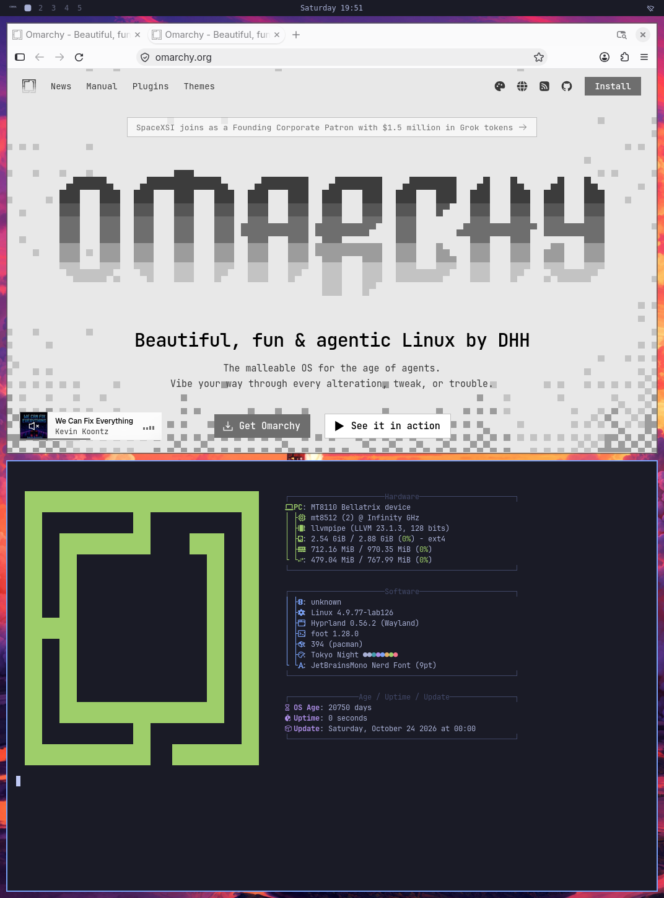
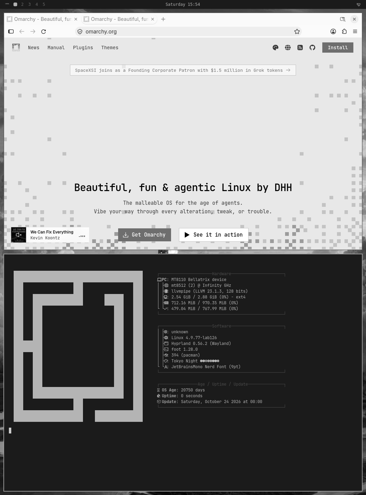
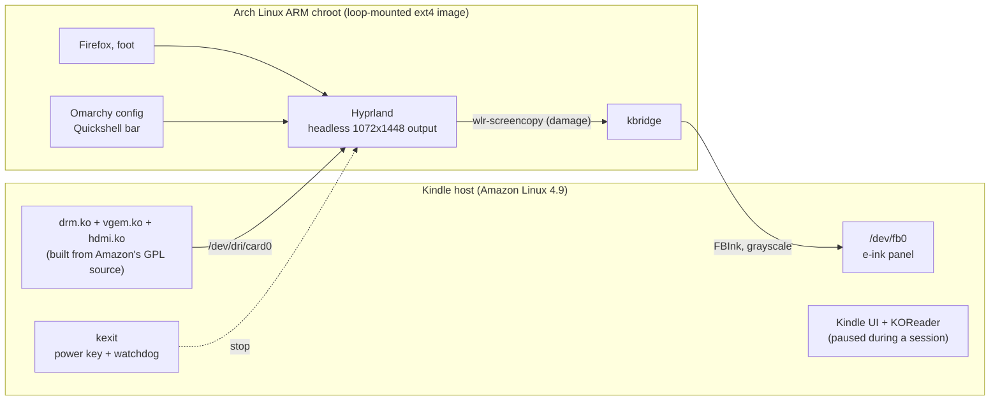

# Omarchy on a Kindle

[Omarchy](https://omarchy.org) running on a Kindle Basic (2024), on the Kindle's own CPU.
Genuine, unpatched Hyprland, Omarchy's own config and Quickshell bar, Firefox, and a foot
terminal, all drawn to the e-ink panel.

<p align="center">
  
  &nbsp;
  
</p>
<p align="center"><sub>Left: what Hyprland renders. Right: the same frame read back from the panel's framebuffer.</sub></p>

## The hardware

| | |
|---|---|
| Device | Kindle Basic 2024 (MT8110 "Bellatrix"), firmware 5.18.1 |
| CPU | 2 ARMv7 cores |
| RAM | 970 MiB |
| GPU | none usable; everything renders on the CPU through Mesa's llvmpipe |
| Display | 1072x1448 e-ink, 8-bit grayscale framebuffer |
| Kernel | Amazon's Linux 4.9.77, no DRM, module signing off |

Hyprland expects a DRM device, a modern kernel, udev, systemd and a GPU. This Kindle has none
of those. Everything below exists to close that gap without patching Hyprland, Aquamarine,
Quickshell or Omarchy.

## How it works



- **A DRM device on a kernel without DRM.** The stock kernel has module loading on and signing
  off, so `drm.ko` and `vgem.ko` are built from Amazon's GPL kernel source against the device's
  own config. `tools/check_imports.py` proves every symbol they import exists in the running
  kernel with the same CRC before anything is loaded. Four small patches in `patches/` make vgem
  work as a render node for Aquamarine.
- **Software rendering.** Hyprland runs on vgem with llvmpipe and a headless output named
  `KINDLE` at the panel's resolution.
- **Getting pixels onto e-ink.** `bridge/kbridge.c` is a Wayland client that captures the output
  through wlr-screencopy, only where something changed, converts it to grayscale and draws it with
  [FBInk](https://github.com/NiLuJe/FBInk).
- **Userland shims, not forks.** `compat/` holds two shims. libudev-zero replaces udev, with a
  patch so the touch panel is tagged as a touchscreen. `qt-sigchld.cpp` fixes Qt's child reaping
  on a kernel without pidfd.
- **Kindle-specific settings live in user config only.** `rootfs/overlay/` sets the monitor,
  input, opaque terminals (translucency ghosts on e-ink), a trimmed bar, and Firefox defaults for
  one content process.
- **Getting out.** `bridge/kexit.c` runs on the host for the length of a session. It grabs the
  power key, so the Kindle cannot suspend under its paused UI. A press, or Hyprland disappearing,
  stops the session and resumes the Kindle UI and KOReader where they were.

## What works

Each of these was checked on the device, with a framebuffer readback as proof:

- Genuine Hyprland 0.56.2 loads Omarchy's own `hyprland.lua` with no config errors.
- The Omarchy bar, workspaces, clock, dock, notifications and background run, and the bar is
  up 18 to 24 seconds after start.
- Firefox runs beside the shell and renders real sites. Together they use about 566 MB, with
  zram swap set up at session start.
- Omarchy themes switch through `omarchy-theme-set`. Tokyo Night is the default.
- Remote control from a Mac with `tools/kctl`, each action returning a checksummed proof bundle.
- Ten start and exit cycles in a row, with the Kindle UI and KOReader back after every one and
  nothing left running.

## Requirements

- A Kindle Basic 2024 on firmware 5.18.1, jailbroken, with root SSH on port 2222 and
  [KUAL](https://www.mobileread.com/forums/showthread.php?t=203326) installed. Other Kindles on
  the same kernel may work but have not been tried.
- About 3.5 GB free on the Kindle's user storage.
- An Apple Silicon Mac with Docker. The kernel toolchain image is arm64, and the Arch Linux ARM
  steps run under QEMU.
- The Kindle GPL source release for firmware 5.18.1 from Amazon's open source page. It contains
  `linux-4.9.tar.gz`.
- An [Omarchy](https://github.com/basecamp/omarchy) checkout. This port was tested at
  commit `80e9460`.

## Build

```sh
cp .kindle.env.example .kindle.env       # set KINDLE_HOST, and KINDLE_KEY if not id_ed25519
. ./.kindle.env
ssh -p 2222 -i "$KINDLE_KEY" root@"$KINDLE_HOST" 'zcat /proc/config.gz' > device.config
./build.sh path/to/linux-4.9.tar.gz device.config
```

`build.sh` runs these steps in order. Pass step names after the two paths to run only some.

| Step | Output |
|---|---|
| `images` | Docker images: a GCC 4.9 kernel toolchain and an Arch Linux ARM build image |
| `kernel` | the stock kernel rebuilt from source, for its symbol versions |
| `drm` | `drm.ko`, `vgem.ko` (patched) and `hdmi.ko` |
| `stage` | stripped modules in `out/stage/`, plus the import check against the stock kernel |
| `compat` | libudev-zero and the Qt shim, staged into the rootfs overlay |
| `bridge` | `kbridge` and `kexit` |
| `rootfs` | a 3 GB ext4 Arch Linux ARM image with the packages in `rootfs/packages.txt` |

The module build is reproducible. Its hashes should match `reference/modules.sha256`.

## Install

Back up first. `device/backup.sh` copies the system partitions and your user data to the Mac,
checksummed on both ends.

```sh
device/backup.sh ~/kindle-backup
device/push.sh rootfs                       # modules, scripts, bridge, KUAL entry, rootfs image
tools/install-omarchy.sh ~/src/omarchy      # Omarchy into the image, with two themes
```

Nothing is flashed. The modules load into the running kernel and are gone after a reboot.
Everything else lives in `/mnt/base-us/omarchy` and `/mnt/base-us/extensions/omarchy`, and
deleting those removes the port.

## Use

On the Kindle, open KUAL and choose **Omarchy > Start Omarchy**. Press the power button to go
back to the Kindle.

From the Mac:

```sh
tools/kctl start
tools/kctl open-url https://omarchy.org
tools/kctl exec foot
tools/kctl about        # Omarchy's About screen
tools/kctl proof        # capture the screen without doing anything
tools/kctl stop
```

Every action except `start`, `stop` and `status` writes a proof bundle to `out/proof/<time>/`.
It has the compositor capture, the panel framebuffer readback, and the window list, all checked
by SHA-256 on both ends.

To change the theme, set `THEME` when provisioning, for example `THEME="White"`. Install the
theme with `tools/install-omarchy.sh` first.

## Limitations

- Touch is wired up but not tuned. The session is driven from the Mac with `kctl` for now, and
  there is no on-screen keyboard.
- Rendering is all on two slow cores. Animations are off, and the panel refreshes only where
  something changed, with a full flash every so often to clear ghosting.
- Memory is tight. Firefox and the shell fit with zram, but heavy pages can still push it.
- The bar is trimmed to what fits. Weather, updates and Bluetooth widgets are off.
- fastfetch reports a few values wrong on this kernel, such as uptime and OS age, and they are
  left as they come.
- Only the watchdog exit has been drilled. The power-button exit has the same code path but has
  not been through the ten-cycle drill.

## Repository layout

| Path | What it is |
|---|---|
| `build.sh` | the whole build |
| `toolchain/` | kernel toolchain image and kernel, DRM and hdmi build scripts |
| `patches/` | vgem patches against the Kindle kernel |
| `bridge/` | `kbridge`, `kexit`, and two diagnostic probes |
| `compat/` | libudev-zero patch and the Qt child-reaping shim |
| `rootfs/` | package list, image build scripts and the config overlay |
| `device/` | scripts that run on the Kindle: session, chroot, modules, provisioning, drill |
| `kual/` | the KUAL menu entry |
| `tools/` | Mac-side control (`kctl`) and the symbol CRC checks |
| `reference/` | the stock kernel's export CRCs, its config, and expected module hashes |

## Credits

- [Omarchy](https://github.com/basecamp/omarchy) by DHH and contributors, used unmodified.
- [Hyprland](https://hyprland.org), [Aquamarine](https://github.com/hyprwm/aquamarine) and
  [Quickshell](https://quickshell.org), used unmodified.
- [FBInk](https://github.com/NiLuJe/FBInk) by NiLuJe, for every pixel on the panel.
- [libudev-zero](https://github.com/illiliti/libudev-zero) by illiliti.
- [Arch Linux ARM](https://archlinuxarm.org).
- The Kindle jailbreak, KUAL and [KOReader](https://koreader.rocks) communities.

## License

MIT for this project's own code. The kernel patches and modules are GPL-2.0, and a distributed
`kbridge` binary is GPL-3.0 because it links FBInk. See [LICENSE](LICENSE) and [NOTICE](NOTICE).
